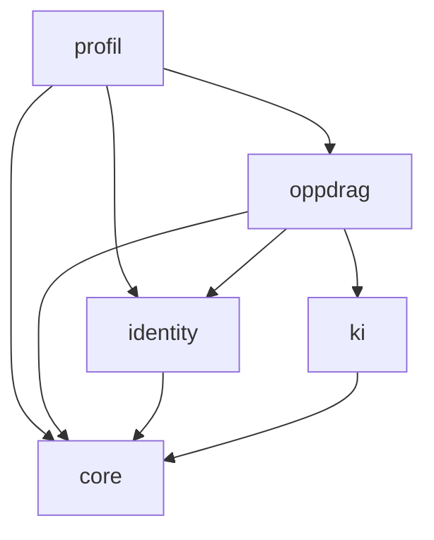
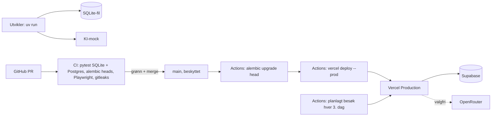
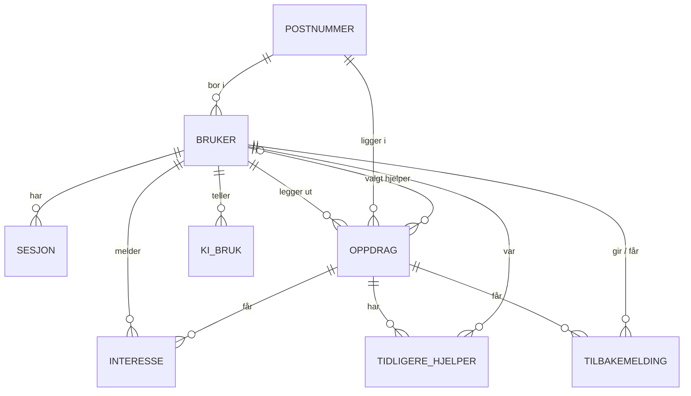

# Arkitekturspine – Nabolagshelten v1

## Design Paradigm

Én **server-rendret monolitt**: FastAPI tar imot forespørselen, reglene kjøres på serveren, og svaret er en ferdig HTML-side fra Jinja. Klienten får **progressiv forbedring**: små vanilla-JS-filer gjør sidene bedre, men har aldri regler. Koden er delt i **vertikale slices** etter funksjon, og hver slice har tre lag:

| Lag | Fil | Ansvar |
|---|---|---|
| routes | `routes.py` + `templates/<slice>/` | Leser skjema, åpner transaksjonen (AD-17), kaller service og viser siden med `core.render`. Ingen regler. |
| service | `service.py` (+ moduler) | Alle regler fra PRD-en: hvem, når, gyldige verdier og statusoverganger. Tar `db: Session` som første parameter. |
| models | `models.py` | SQLAlchemy-tabeller og spørringer. Ingen regler. |

`core/` er felles kjerne: konfig, database, mellomvare, sesjonsgrensesnitt, CSRF, klokke, tid, domeneverdier, postnummer, feiltyper, `render`, basismaler, makroer og felles JS. Den importerer ingen slice.

## Invariants & Rules



Pilene betyr «kan importere fra». Bare direkte piler gjelder.

### AD-1 — Avhengigheter går én vei, og hver tabell har én eier [ADOPTED]

- **Binds:** all
- **Prevents:** at regler dupliseres i ruter og maler, sirkulære importer, og at to slices skriver samme tabell med ulike regler.
- **Rule:**
  - En slice bruker en annen bare gjennom dens `service.py`, og bare i retningen i figuren.
  - `core` når slices bare gjennom grensesnitt som `lag_app()` kobler til ved oppstart: `Autentisering` (AD-4) og menykroken `(db, bruker_id) -> int` (konvensjonen Rendring). Mangler en kobling, nekter `lag_app()` å starte.
  - Bare eier-slicen skriver til en tabell:

    | Eier | Tabeller |
    |---|---|
    | identity | bruker, sesjon, innloggingsforsok |
    | oppdrag | oppdrag, interesse, tidligere_hjelper, tilbakemelding |
    | ki | ki_bruk |
    | core | postnummer (skrives bare av migreringen) |

  - Postnumre er referansedata. En Alembic-datamigrering laster dem fra `data/postnumre.tsv`, slik at de finnes i alle miljøer. Fila kommer fra Brings postnummerregister (`https://www.bring.no/postnummerregister-ansi.txt`), som Felles datakatalog oppgir under NLOD 2.0. README oppgir kilden: «Postnummerdata fra Posten Bring, lisensiert under NLOD 2.0.» All tilgang går gjennom `core/postnummer.py` (`normaliser_postnummer`, `finnes`, `poststed`). Postnummer lagres som tekst med fire sifre.
  - Unntak: `app/seed.py` og testfabrikkene skriver eksempeldata direkte med modellene, bare når `APP_ENV` er `local` eller `test`. Seed tømmer aldri `postnummer`.

### AD-2 — Status og statusavhengige skrivinger er atomiske [ADOPTED]

- **Binds:** §4.0, FR-4, FR-6, FR-7, FR-12–FR-17, FR-19, FR-20
- **Prevents:** at to samtidige handlinger begge lykkes, dobbel innsending, lese-så-skriv-kappløp, og ulik oppførsel i SQLite og Postgres.
- **Rule:**
  - **Status:** All endring av `oppdrag.status` går gjennom én funksjon i `oppdrag/service.py`. Lovlige verdier: `apen`, `hjelper_valgt`, `utfort`, `avbrutt`.
  - **Andre skrivinger** som avhenger av status (redigere, melde og trekke interesse, fjerne hjelper og trekke seg, slette oppdrag) starter med `UPDATE oppdrag SET versjon = versjon + 1 …`.
  - **Rekkefølge:**
    - Den betingede `UPDATE`-en er første setning i transaksjonen. `WHERE` har med alt som kan sjekkes på raden: `id`, `status`, eier når handlingen krever det, og `tidspunkt > :na` når PRD-en krever at det ikke er passert.
    - Sjekker mot andre tabeller (interesse finnes, `tidligere_hjelper`, slettet bruker) gjøres etter `UPDATE`-en.
    - Endres 0 rader, leser servicen raden på nytt og kaster `FinnesIkke` eller `Konflikt` («Oppdraget er endret. Last siden på nytt.»).
  - **SQLite og Postgres:** `core/db.py` starter skrivetransaksjoner i SQLite med `BEGIN IMMEDIATE`, gjør om «database is locked» til `Konflikt`, og slår på `PRAGMA foreign_keys=ON`. Migreringene bruker ikke `ON DELETE CASCADE`, og servicen sletter barn eksplisitt etter `UPDATE`-en.
  - **Engangsregler** har unik-constraint i databasen: `interesse(oppdrag_id, bruker_id)`, `tilbakemelding(oppdrag_id, giver_id)`, `oppdrag.skjema_id` (skjult engangsfelt i «Nytt oppdrag») og `bruker.epost`. `IntegrityError` fanges med SAVEPOINT (AD-17). `skjema_id` blir `Duplikat` (brukeren sendes til oppdraget som finnes), og de andre blir `RegelBrudd` eller `Konflikt`.
  - **Når hjelperen går:** `tidligere_hjelper(oppdrag_id, bruker_id, arsak, tidspunkt)` har `arsak` i `fjernet | trakk_seg | slettet` og ingen unik-constraint. Bare overgangen `hjelper_valgt → apen` skriver den, og den samme overgangen sletter den valgte hjelperens interesse. FR-17 og FR-4 kaller begge denne overgangen.

### AD-3 — Avledede tilstander beregnes ved lesing [ADOPTED]

- **Binds:** FR-6, FR-8, FR-9, FR-12, FR-14, FR-16, FR-18, FR-19, FR-21, NFR-11
- **Prevents:** at «utgått» og merker lagres på ulike måter, og at det trengs bakgrunnsjobber i appen.
- **Rule:**
  - **Beregnes alltid fra lagret status, tidspunkt og nå:** utgått, «Er jobben gjort?», merkene i «Mine oppdrag» (blant annet «Velg hjelper») med antallet i menyen, og om telefonnummer er synlig. De lagres aldri, og appen har ingen cron-jobber. Hver av dem har én funksjon i `oppdrag/service.py`.
  - **«Meldt før endring»** betyr `interesse.opprettet < oppdrag.vesentlig_endret`. Redigering setter `vesentlig_endret` når tidspunkt, godtgjørelse eller postnummer endres.
  - **Fjernet og trukket fra:** «Fjernet» (FR-12) betyr at det finnes en rad i `tidligere_hjelper` med `arsak='fjernet'`. «Hjelperen trakk seg» betyr at status er `apen` og at den nyeste raden har `arsak` `trakk_seg` eller `slettet`.
  - **Erfaring:** `erfaring(db, bruker_ids) -> dict[int, Erfaring]` brukes av FR-9, FR-14, FR-18 og FR-21. Typen `Erfaring` ligger i `core/domene.py`, med feltene `fullforte`, `per_kategori`, `snitt | None` og `antall_vurderinger`.
  - **Klokka:** brukes alltid som `klokke.na()` etter `from app.core import klokke`.

### AD-4 — Innlogging kreves som standard, bak ett grensesnitt [ADOPTED]

- **Binds:** FR-2, FR-3, FR-4, NFR-5, NFR-9
- **Prevents:** at en ny rute glemmer tilgangskontroll, at det finnes to innlogginger, og at sesjoner eller tellere ligger i minnet (Vercel har ikke minne mellom kall).
- **Rule:**
  - **Grensesnittet:** `core/sesjon.py` definerer `Autentisering` med `finn_innlogget`, `logg_inn` og `logg_ut`, og dataklassen `Innlogget` (`bruker_id`, `visningsnavn`). `identity/service.py` er implementasjonen. Mellomvaren og FR-2-ruta kaller bare dette grensesnittet. `core` leser og skriver aldri `sesjon`, `bruker` eller `innloggingsforsok`.
  - **Tilgang:** Mellomvaren setter `request.state.innlogget`, og ruter får brukeren bare gjennom avhengigheten `core.innlogget_bruker`. Alle ruter krever innlogging, unntatt dem som er merket offentlige på selve ruta (`/logg-inn`, `/registrer`, `/static`). FR-3-testen leser merkingen.
  - **Uten gyldig sesjon:**
    - GET gir 303 til `/logg-inn?neste=<sti>`. `neste` godtas bare når den begynner med `/` og ikke med `//`.
    - POST følger AD-7.
    - Forespørsler med `X-Fragment: 1` gir 401 med fragmentet «Du må logge inn igjen.».
  - **Sesjonen:** en tilfeldig nøkkel i en HttpOnly-cookie med `SameSite=Lax`, og `Secure` når `APP_ENV=production`. Den lagres i `sesjon` og gjelder i høyst 7 dager fra innlogging. Den slettes ved utlogging og ved sletting av konto.
  - **Innloggingsforsøk:** mislykkede forsøk telles per normalisert e-post i `innloggingsforsok`. Etter 5 innen 15 min avvises nye forsøk i 15 min.
  - **Opprydding:** ved vellykket innlogging slettes radene for e-posten og utløpte sesjoner. Ved hvert forsøk slettes rader eldre enn 15 min.

### AD-5 — Mellomvare i fast rekkefølge, én CSRF-mekanisme og felles headere [ADOPTED]

- **Binds:** NFR-12, alle POST-ruter
- **Prevents:** ulik eller manglende beskyttelse per skjema, at innlogging skjer før CSRF-sjekken, at skjemaet blir tomt for ruta, og clickjacking.
- **Rule:**
  - **Rekkefølge:** `lag_app()` registrerer all mellomvare på ett sted, fra ytterst: feilhåndtering → sikkerhetsheadere → CSRF/Origin → sesjon og innlogging (AD-4, AD-7) → ruter.
  - **Lesing av skjemaet:** Mellomvaren er ren ASGI. CSRF-mellomvaren leser skjemaet én gang, legger feltene i `request.state.skjema` og spiller av kroppen på nytt for ruta.
  - **CSRF-sjekk:** Alle skjema har et skjult felt med samme nøkkel som en signert cookie (HMAC med `SECRET_KEY`). POST der de ikke stemmer avvises, også før innlogging og for `fetch`.
  - **CSRF-nøkkelen:** CSRF-cookien er uavhengig av sesjonen. Den byttes bare når den mangler, og leses bare fra `request.state.csrf`.
  - **Origin:** `Origin` sammenlignes med forespørselens `Host`. Mangler `Origin`, avgjør `Sec-Fetch-Site`. Mangler begge, avgjør CSRF-nøkkelen alene.
  - **Bare POST endrer:** Alle endringer skjer med POST.
  - **Headere på alle svar:** `Content-Security-Policy: frame-ancestors 'none'`, `X-Frame-Options: DENY`, `X-Content-Type-Options: nosniff` og `Referrer-Policy: same-origin`.

### AD-6 — Passord og e-post behandles bare på ett sted [ADOPTED]

- **Binds:** NFR-4, FR-1, FR-2, FR-4
- **Prevents:** at passord over 72 byte gir feil (bcrypt 5 avviser dem, og PRD-en tillater 64 tegn), og at registrering og innlogging normaliserer ulikt.
- **Rule:**
  - `identity/service.py` har `hash_passord` og `sjekk_passord`. De NFC-normaliserer passordet uten å trimme det, og kjører bcrypt over base64(SHA-256(passord)). Ingen annen kode kaller bcrypt.
  - `normaliser_epost` trimmer, NFC-normaliserer og gjør om til små bokstaver. Den kjøres før lagring og før alle oppslag.
  - Manuell tilbakestilling og sletting (PRD §6.2) gjøres med `uv run python -m app.admin nytt-passord|slett-konto <e-post>`, som kaller de samme funksjonene.

### AD-7 — Utløpt innlogging mister aldri utfylt innhold [ADOPTED]

- **Binds:** FR-2, FR-3, EXPERIENCE.md «Innlogging utløpt»
- **Prevents:** at noen ruter sender til innlogging og mister skjemaet mens andre beholder det, og at innhold fra databasen vises uten innlogging.
- **Rule:**
  - **Svaret:** POST uten gyldig sesjon endrer ingen data. `core` svarer 401 med én generisk side, «Du må logge inn igjen.». Siden har:
    - alle innsendte felt som skjulte felt, unntatt passord og CSRF
    - en ny CSRF-nøkkel
    - feltene `_innlogging_epost` og `_innlogging_passord`
    - en knapp som sender til samme URL

    Siden viser ikke noe innhold fra databasen.
  - **Innsending:** Mellomvaren logger inn gjennom `Autentisering`, fjerner `_innlogging_*`-feltene og slipper forespørselen videre. Ruta behandler den som den nye innloggede brukeren, og tilgangsreglene i servicen gjelder som vanlig.
  - **Feltnavn:** Ingen andre skjema bruker feltnavn som begynner med `_`.
  - **Kan kuttes:** Står AD-7 i veien for fristen, kan den erstattes av en 401-side med «Du må logge inn igjen.» og en lenke til innlogging. Endringen føres i memlog og i PRD §9.2.

### AD-8 — Slettet bruker blir en gravstein, og slettingen styres ett sted [ADOPTED]

- **Binds:** FR-4, FR-17, FR-20, FR-21, NFR-9
- **Prevents:** brutte fremmednøkler fra oppdrag og tilbakemeldinger som beholdes, ulik visning av «Slettet bruker», og personopplysninger som blir liggende.
- **Rule:**
  - `bruker`-raden beholdes med samme id. Alle personfelt settes til NULL, og `slettet_tidspunkt` settes.
  - Visningsnavnet «Slettet bruker» kommer fra én funksjon i `identity/service.py`.
  - `profil/service.py` styrer slettingen i forespørselens ene transaksjon (AD-17):
    - `oppdrag` utfører tabellen i FR-4, med overgangen fra AD-2 der hjelperen går.
    - `identity` sletter brukerens rader i `sesjon` og alle rader i `innloggingsforsok` med e-posten.
  - `ki_bruk` inneholder ingen personopplysninger og ryddes etter 60 min (AD-12).
  - En test feiler slettingen til slutt med vilje og sjekker at ingenting er endret, både mot SQLite og mot Postgres.

### AD-9 — Tid lagres i UTC, og tolkes og vises ett sted i norsk tid [ADOPTED]

- **Binds:** FR-1, FR-5, FR-6, FR-8, FR-10, FR-19, NFR-2
- **Prevents:** at noen lagrer lokal tid og andre UTC, at SQLite og Postgres gir ulike datetime-objekter, og at fødselsdato og oppdragstid tolkes ulikt.
- **Rule:**
  - **Lagring:** Alle tidskolonner bruker typen `UtcDateTime` i `core/db.py`. Den lagrer UTC og gir alltid tilbake aware UTC. Fødselsdato er `Date`.
  - **Nå og i dag:** `klokke.na()` gir aware UTC. «I dag» er datoen i `Europe/Oslo`, også når alder regnes ut (FR-1).
  - **Tolkning og visning:** `core/tid.py` eier tolkningen av dato og klokkeslett fra tekstfelt og visningen (Jinja-filtrene `tidspunkt` og `dato_kort`), etter formatene i EXPERIENCE.md. Den bruker `zoneinfo` med `tzdata`.
  - **Tosifret år:** betyr 20xx for oppdrag. For fødselsdato er det det året som gir en alder mellom 0 og 120.
  - **Sommertid:** Klokkeslett som ikke finnes når klokka stilles fram om våren, avvises. Klokkeslett som finnes to ganger om høsten, tolkes som det første (`fold=0`).
  - **Feil og test:** Funksjonene kaster `RegelBrudd` med tekstene fra EXPERIENCE.md. Én tabelltest dekker alle skrivemåtene og en rundtur over skiftet til og fra sommertid.

### AD-10 — Tekst er UTF-8, normaliseres, og domeneverdier står ett sted [ADOPTED]

- **Binds:** FR-1, FR-5, FR-11, FR-20, FR-22, FR-23, FR-25, NFR-10
- **Prevents:** at samme tekst får ulik lengde i ulike slices eller på klienten, at KI-svar og skjema sjekkes mot ulike grenser, og at kategorier lagres som tekst som kan endre seg.
- **Rule:**
  - Alt er UTF-8: filer, maler, database og postnummerfila. Brings fil er Latin-1/cp1252 og konverteres én gang.
  - Tekst fra brukere og KI trimmes og NFC-normaliseres før lengden sjekkes med `len()`. Passord trimmes ikke (AD-6).
  - `core/domene.py` har det som brukes av mer enn én slice:
    - `KATEGORIER` som en ordnet liste av `(kode, tekst)` med ASCII-koder
    - statusordene
    - grensene for tittel og beskrivelse

    Andre grenser ligger i eier-slicen.
  - Database, URL-er og skjemaverdier bruker kategorikoden. Bare Jinja-filteret `kategori_tekst` viser teksten.
  - Malen får grensen som `data-maks`. Telleren på klienten teller kodepunkter etter NFC og trim. Felt med teller har ikke `maxlength`.

### AD-11 — Bruker- og KI-tekst vises alltid som tekst [ADOPTED]

- **Binds:** NFR-12, FR-25
- **Prevents:** XSS.
- **Rule:**
  - Jinja autoescape er på for alle maler.
  - `|safe` og `Markup` brukes aldri på tekst fra brukere eller KI.
  - JavaScript setter aldri inn slik tekst med `innerHTML`, bare ferdige fragmenter fra serveren (AD-15).
  - En test i `tests/core/test_arkitektur.py` sjekker at `|safe`, `Markup(` og `innerHTML` ikke finnes i `app/` utenom en tillatt liste. Samme test sjekker importretningen i AD-1.

### AD-12 — KI bak ett grensesnitt med tre utgaver [ADOPTED]

- **Binds:** FR-23–FR-26, NFR-1, NFR-9
- **Prevents:** at KI-kall, mock og testdobbel bygges ulikt, at appen krever nøkkel, at tester bruker ekte KI, og at en transaksjon står åpen under et eksternt kall.
- **Rule:**
  - **Utgaver:** `ki/` har ett grensesnitt med tre utgaver:
    - OpenRouter via `httpx`, med en samlet frist på 10 s rundt hele kallet. Svar etter fristen forkastes.
    - Mock, når `OPENROUTER_API_KEY` er tom eller plassholder, og alltid når `APP_ENV=test`.
    - Testdobbel, som byttes inn per test.
  - **Valg av utgave:** Utgaven velges ett sted. `sender_eksternt()` sier om tekst sendes ut, så malen kan vise riktig tekst. Ingen annen kode leser KI-konfigurasjonen.
  - **Validering og innhold:** Svaret valideres likt for alle utgaver (FR-25), mot `core/domene.py`, og kategori godtas bare som kode. Bare beskrivelsesteksten sendes, og prompten ligger i en egen fil.
  - **Kvote:** 20 per bruker i glidende 60 min, i `ki_bruk`. Kvotesjekken og registreringen skjer i en egen kort transaksjon som committes **før** kallet. Ingen transaksjon er åpen under kallet. Rader eldre enn 60 min slettes ved telling. Én eller to ekstra ved samtidige forespørsler godtas.
  - **Kostnad:** Produksjon bruker en OpenRouter-nøkkel med kredittgrense satt i OpenRouter, eller en gratismodell. Uten grense kjører produksjon i mock.

### AD-13 — Samme kode og samme migreringer mot SQLite og Postgres [ADOPTED]

- **Binds:** NFR-1, NFR-2, all databasetilgang
- **Prevents:** kode og migreringer som bare virker lokalt eller bare på Vercel, og flere Alembic-hoder etter parallelle stories.
- **Rule:**
  - **Database-lag:** Synkron SQLAlchemy 2.1 med `psycopg[binary]` 3 (`postgresql+psycopg://`), uten databasespesifikk SQL.
  - **Skjemaendringer:** gjøres bare med Alembic, aldri med `create_all`. `migrations/env.py` bruker `render_as_batch=True`, og migreringsmalen importerer `app.core.db`.
  - **Én migrering per story,** som gjennomgås i PR-en.
  - **Ett hode:** CI feiler hvis `alembic heads` gir mer enn én linje.
  - **Bare tillegg:** Etter første produksjonspublisering legger migreringer bare til (nye tabeller, og kolonner som kan være NULL). Da er Vercel Instant Rollback alltid trygt.
  - **Tilkobling:**
    - Appen kobler til Supabase gjennom transaction pooler (`DATABASE_URL`, port 6543) med `NullPool` og `prepare_threshold=None`.
    - Alembic i GitHub Actions bruker session pooler (`MIGRATION_DATABASE_URL`, port 5432), fordi Actions bare har IPv4.

### AD-14 — Miljøet styres av `APP_ENV`, og produksjon starter ikke med standardverdier [ADOPTED]

- **Binds:** NFR-1, NFR-2, NFR-3, FR-26
- **Prevents:** at appen krever kontoer lokalt, eller kjører i produksjon med kjente hemmeligheter, demokontoer eller testbrytere.
- **Rule:** All konfig leses fra én `Settings` (pydantic-settings) i `core`. Er verdien av `APP_ENV` ukjent, starter ikke appen.

  | `APP_ENV` | Database | Seed og demokontoer | `Secure`-cookie | Krever ekte `SECRET_KEY` | Testbrytere og `/_test/tilstand` |
  |---|---|---|---|---|---|
  | `local` | SQLite-fil | ja | nei | nei | nei |
  | `test` | midlertidig SQLite-fil eller Postgres (CI) | fabrikker | nei | nei | ja |
  | `production` | Supabase | nei | ja | ja | nei (gir 404) |

### AD-15 — KI-forslag er den eneste forespørselen uten sidelasting [ADOPTED]

- **Binds:** FR-23, FR-24, FR-25, NFR-7, EXPERIENCE.md § KI-forslag
- **Prevents:** at «Nytt oppdrag» og KI-storyen bygger hver sin modell (hel sidelasting mot JSON med `innerHTML`), og XSS fra KI-tekst.
- **Rule:**
  - **Forespørselen:** `POST /oppdrag/forslag` i `oppdrag/routes.py` kaller `ki`. `ki.js` sender skjemaets `FormData` med `fetch` og `X-Fragment: 1`, så CSRF-feltet blir med (AD-5).
  - **Svaret:** Ruta svarer med et HTML-fragment fra `core.render_fragment` og samme Jinja-makro som forslagsboksene.
    - Feil, kvote og tidsavbrudd gir et feilfragment med 200.
    - Utløpt sesjon gir 401 (AD-4).
    - CSRF-avvisning, 404 og 500 gir det generelle feilfragmentet.
  - **I nettleseren:** `ki.js` setter inn bare svar med 200 eller 401, i faste beholdere. Skriptet styrer «Lager forslag …», `aria-live` og fokus ved «Bruk» og «Forkast».
  - **Uten JavaScript** er «Få forslag» skjult. Det er et uttrykkelig unntak, fordi KI er valgfritt.
  - **Ingen andre** funksjoner henter data uten sidelasting, så det finnes ingen «Laster …»-tilstander.

### AD-16 — Personopplysninger når aldri malen uten en regel [ADOPTED]

- **Binds:** FR-16, FR-21, FR-22, NFR-9
- **Prevents:** at telefon, e-post eller fødselsdato havner i HTML fordi en rute sendte et helt brukerobjekt til malen.
- **Rule:**
  - Maler får aldri ORM-objekter for `bruker`. `identity/service.py` gir bare tre typer:
    - `OffentligBruker` (id, visningsnavn, postnummer med poststed, slettet)
    - `Profil` (i tillegg «om meg», til FR-21)
    - `EgneOpplysninger` (i tillegg telefon, e-post og fødselsdato, bare til «Rediger profil»)
  - Telefonnummer til motparten gis bare av `oppdrag/service.telefon_for_motpart(db, oppdrag, seer)`.
  - En test søker etter testbrukernes telefon, e-post og fødselsdato i HTML fra alle GET-ruter.

### AD-17 — Én transaksjon per forespørsel, eid av ruta [ADOPTED]

- **Binds:** all databasetilgang, FR-4, AD-2, AD-8
- **Prevents:** halvveis lagret sletting, at en service committer midt i en annen service sin transaksjon, og at Postgres havner i en avbrutt transaksjon mens SQLite fortsetter.
- **Rule:**
  - **Sesjon:** `core/db.py` har avhengigheten `hent_db()`, som gir én `Session` per forespørsel. Ingen service oppretter egne sesjoner.
  - **Transaksjonen:** En POST-rute kjører alle service-kall inne i `with db.begin():` og bygger svaret etter blokken. Services kaller aldri `commit()` eller `rollback()`, men kan kalle `flush()`. En service som kaller en annen service, deler `db` og transaksjonen.
  - **Fange databasefeil:** En service som må fange `IntegrityError`, gjør det rundt én setning med `with db.begin_nested():` (SAVEPOINT). `core/db.py` setter opp SAVEPOINT for pysqlite.
  - **Unntak:** KI-kvoten (AD-12) er det eneste stedet der én forespørsel har to transaksjoner.

## Consistency Conventions

| Concern | Convention |
| --- | --- |
| Navn | Domeneordene fra PRD §3 brukes i kode, tabeller og URL-er. Identifikatorer er ASCII: æ → ae, ø → o, å → a. Tabellnavn i entall. |
| URL-er og rutenavn | `/` (oversikt) · `/logg-inn` · `/logg-ut` (POST) · `/registrer` · `/oppdrag/ny` · `/oppdrag/{oppdrag_id:int}` · `/oppdrag/{oppdrag_id:int}/rediger` · `/oppdrag/{oppdrag_id:int}/<handling>` (GET viser bekreftelsessiden, POST utfører handlingen) · `/oppdrag/forslag` · `/mine-oppdrag` · `/profil` · `/profil/{bruker_id:int}` · `/profil/rediger` · `/profil/slett`. Stiparametre bruker alltid `:int`. Rutenavn er `<slice>.<handling>`, maler lenker bare med `url_for`, og en test sjekker at rutenavnene er unike. |
| Id-er og data | Heltall som primærnøkkel. Penger som heltall i kroner, og «uten betaling» som NULL. Kategori som kode (AD-10). Status etter AD-2. Tid etter AD-9. |
| Validering | Skjemamodellene har bare felt av typen `str \| None = None`, uten Pydantic-begrensninger. All tolkning og alle regler ligger i service og `core/tid.py`. En egen handler for `RequestValidationError` viser den vennlige feilsiden og logger. |
| Feil | Typene ligger i `core/feil.py`, og hver av dem har én handler i `core`. Rutene fanger dem ikke selv. <br>• `RegelBrudd(feil: list[(felt, melding)])` gjelder skjema med felt. Skjemaet vises på nytt med 422, alle feilene samtidig, og verdiene beholdes (ikke passord). <br>• `Konflikt(melding, til_url)` gjelder AD-2 og avvisning av handlinger uten felt. Den gir POST → redirect → GET til `til_url`, med meldingen i cookien. <br>• `Duplikat(til_url)` gir POST → redirect → GET til det som allerede finnes. <br>• `IngenTilgang` og `FinnesIkke` gir begge 404 og samme side, med teksten fra FR-4 for slettet bruker. <br>• Uventede feil gir en vennlig side, aldri en stack trace (NFR-10). Feilhandlerne ruller tilbake og rendrer uten databasekall. |
| Etter vellykket handling | POST → redirect → GET. Kvitteringen eller feilmeldingen ligger i en kortlivet signert cookie (`itsdangerous`) og vises på neste side. |
| Rendring | Alle sider rendres med `core.render(request, mal, *, tittel, aktiv_meny, fokus=None, **ctx)`. Den legger til innlogget bruker, `request.state.csrf`, kvittering, «Feil: » foran tittelen ved feil, `aria-current`, antallet i menyen (kroken, bare når noen er innlogget) og `tilbake_url` (`Referer` fra samme nettsted, ellers `/`). Fragmenter rendres med `core.render_fragment`, som verken leser kvitteringen eller kaller kroken. <br>Maler ligger i `app/<slice>/templates/<slice>/` og brukes som `"oppdrag/detaljer.html"`. Det finnes ett Jinja-miljø. `core/makroer.html` har blant annet `brukerkort(bruker, erfaring, lenke=True)`, `bekreft_dialog`, `feltfeil` og `kvittering`. Filtrene `status_tekst`, `kategori_tekst`, `vurdering`, `tidspunkt` og `kr` ligger i `core`, og maler formaterer aldri selv. `base.html` har menyen (NFR-11). |
| Fokus og opplesning | Høyst ett fokusmål per side, satt med `autofocus` fra makroen. Rekkefølge: feiloppsummering > feilmelding > kvittering > sidens eget mål. Etter sidelasting er det fokuset som gir opplesningen. `role="status"`, `role="alert"` og `aria-live` brukes bare på fragmenter som JS setter inn. Feiloppsummeringen har aldri `role`. |
| Klientatferd | Én fil per oppgave i `core/static/js/`, uten npm og uten byggsteg. JS har aldri regler fra PRD-en, og serveren bestemmer alltid. <br>• `fokus.js` gjør `select()` og viser riktig steg. Uten JS: `autofocus` alene. <br>• `dialog.js` viser de fem bekreftelsene som `<dialog>` fra `bekreft_dialog`. Uten JS: en GET-bekreftelsesside med POST-knapp. <br>• `sending.js` setter `aria-disabled` på knappen som sendte, og nullstiller ved `pageshow`. Uten JS: serveren avviser duplikater (AD-2). <br>• `steg.js` gjør det ene skjemaet i «Nytt oppdrag» om til to steg under 768 px. Uten JS: én skjerm. <br>• `ki.js` følger AD-15. Uten JS: knappen er skjult. <br>• `skjema.js` har teller, poststed fra `postnumre.json`, «Vis passord» og forhåndsvisning med dato og klokkeslett slik brukeren skrev dem. Uten JS vises disse etter innsending. <br>• «Beløp i kr» styres med CSS (`:has(:checked)`). <br>`core/static/postnumre.json` lages av `uv run python -m app.core.postnummer` fra TSV-fila og sjekkes inn. En test sammenligner de to. |
| Filtre | Filtrene er GET-parametre (`postnummer`, `kategori`, `fane`). Én hjelper bygger lenkene og beholder de andre parametrene. |
| Lagringstid | Appen har ingen cron, så eier-slicen rydder når den brukes (AD-4, AD-12). |
| Konfig og hemmeligheter | Appen leser `APP_ENV`, `DATABASE_URL`, `SECRET_KEY`, `OPENROUTER_API_KEY` og `OPENROUTER_MODEL`. De står i `.env.example` uten ekte verdier, og i Vercel env (Production). `MIGRATION_DATABASE_URL` og `VERCEL_TOKEN` står bare i GitHub Secrets. Workflows bruker aldri `pull_request_target`. Bytte av `SECRET_KEY` logger ingen ut (sesjonene ligger i databasen), men gjør CSRF- og kvitteringscookies ugyldige. |
| Logging | Standard `logging`. Passord, telefonnumre, e-post, sesjonsnøkler og KI-tekst logges aldri. |
| Tester | **Kommandoer:** `uv run pytest` og `uv run python -m app.seed`. <br>**Database:** Testene bruker en midlertidig SQLite-fil (Postgres-container i CI), og `alembic upgrade head` kjøres én gang per testkjøring. Hver test kjører i en ytre transaksjon som rulles tilbake (`join_transaction_mode="create_savepoint"`). <br>**Fabrikker og fixturer:** `tests/conftest.py` eier `lag_bruker`, `lag_oppdrag`, `lag_interesse`, `lag_tilbakemelding` og `sett_na(tidspunkt)`. Slicene lager ikke egne fixturer med de samme navnene. Klienten lages med `lag_app()` og `dependency_overrides[hent_db]`. <br>**Hva som testes:** <br>• hver regel direkte mot serveren (NFR-5), inkludert dobbel innsending <br>• FR-3-testen, som forventer 303 for GET og 401 for POST <br>• CSRF, headere og rekkefølgen på mellomvarene i `tests/core/` <br>• arkitekturtesten (AD-11) <br>**E2E:** Testene kaller `POST /_test/tilstand` (klokke, KI-utgave og ny seed) først. T1 er automatisk med axe i Playwright ved 360 og 1280 px, og sjekker at det ikke er vannrett rulling ved 320 px. T2–T6 er manuelle protokoller i `docs/tester/`. <br>**gitleaks** kjører på hele historikken i CI. |
| Sporbarhet | Commits, tester og docstrings for regler oppgir krav-ID-en (for eksempel `FR-15`). |

## Stack

| Name | Version |
| --- | --- |
| Python | 3.12 (`requires-python >=3.11`, `.python-version`) |
| uv | med `uv.lock`, testverktøy i `[dependency-groups] dev` |
| FastAPI | ~=0.165.0 |
| Starlette (følger FastAPI) | 1.x |
| Uvicorn (lokalt) | 0.54.x |
| Jinja2 | 3.1.x |
| python-multipart | 0.0.34 |
| SQLAlchemy | 2.1.x |
| Alembic | 1.20.x |
| psycopg[binary] | 3.3.x |
| Pydantic | 2.14.x |
| pydantic-settings | 2.16.x |
| bcrypt | 5.0.x |
| itsdangerous | 2.2.x |
| httpx | 0.28.x (<1.0) |
| tzdata | 2026.6 |
| pytest | 9.2.x |
| Playwright + pytest-playwright | 1.65.x / 0.10.x |
| axe-playwright-python | 0.1.x (reserve: `axe-core` via `page.add_script_tag`) |
| gitleaks | siste i CI |
| Vercel (Python runtime, FastAPI) | Hobby |
| Supabase Postgres | Free, ett prosjekt |
| OpenRouter | valgfri, mock uten nøkkel |

## Structural Seed

### Miljøer og publisering



| Miljø | Database | KI | Hemmeligheter |
|---|---|---|---|
| Lokalt | SQLite-fil, eksempeldata | mock | ingen (`.env` valgfri) |
| Test/CI | midlertidig SQLite-fil + Postgres-container | mock, testdobbel per test | ingen |
| Produksjon | Supabase | OpenRouter med kredittgrense, eller mock | Vercel env og GitHub Secrets |

- **Main er beskyttet:** endringer kommer bare via PR med grønn CI.
- **Publisering:** Automatisk publisering fra `main` er slått av i `vercel.json` (`git.deploymentEnabled.main: false`). Det samme gjelder preview-publisering. En Actions-jobb på `main` migrerer først og publiserer deretter.
- **Vercel-oppsett:** Vercel bruker `app` i `main.py` i roten, og hele appen kjører som én Vercel Function. `vercel.json` setter `functions."main.py".maxDuration = 30`. Statiske filer mountes på `/static`.
- **Lokalt:** `uv run python -m app.seed` kjører først `alembic upgrade head`, som også laster postnumre, og laster så eksempeldata.
- **Kontoer:** Én i gruppen eier Vercel, Supabase og OpenRouter, og én reserveperson har innlogging til Supabase. Hvem som har hvilken rolle, står i README. Ingen hemmeligheter ligger i repoet (NFR-3).
- **Supabase-pause:** Supabase Free pauser etter 7 dager uten trafikk. En planlagt Actions-jobb besøker appen hver tredje dag. README sier at eieren også sjekker Supabase før demo og innlevering.

### Første story

Første story er et skjelett som går helt gjennom kjeden:
- `lag_app()` med mellomvare i riktig rekkefølge. Lesing av skjemakroppen i ren ASGI-mellomvare prøves ut her.
- `core.render` og `base.html`
- innlogging gjennom `Autentisering`
- én migrering med postnumre
- seed, og grønn CI
- produksjonspublisering på Vercel mot Supabase, med migrering først

Andre stories starter først når denne er ferdig.

### Prioritet for infrastruktur

| Må (bygges først) | Kan kuttes, i denne rekkefølgen |
|---|---|
| Lokal kjøring med SQLite, seed og mock (NFR-1, NFR-2) | 1. Gjenvisning av skjema med innlogging i AD-7 (erstattes av en 401-side med lenke) |
| pytest mot SQLite, CSRF og headere, FR-3-testen | 2. Postgres-jobben i CI (erstattes av én manuell kjøring før innlevering, som dokumenteres) |
| Produksjonspublisering på Vercel med Supabase, med migrering først | 3. `steg.js` (uten JS: én skjerm) |
| gitleaks (NFR-3), axe i Playwright (SM-5) | 4. Den planlagte besøksjobben (erstattes av manuell sjekk før demo) |

Hvert kutt føres i memlog og i PRD §9.2, slik PRD §6.1 sier.

### Datamodell (bare navn og relasjoner)



`INNLOGGINGSFORSOK` er knyttet til normalisert e-post, ikke til en bruker.

### Kildetre

```text
main.py                 # Vercel-entrypoint: app = lag_app()
app/
  core/                 # config, db (UtcDateTime, hent_db), mellomvare, sesjon (Autentisering), csrf,
                        # headere, klokke, tid, domene, postnummer, feil, render
    templates/core/     # base.html, makroer.html, feilsider, «Du må logge inn igjen»
    static/             # css/, js/ (fokus, dialog, sending, steg, ki, skjema), postnumre.json
  identity/             # FR-1–FR-3, Autentisering-implementasjon, OffentligBruker/Profil/EgneOpplysninger
  oppdrag/              # FR-5–FR-20: oppdrag, interesse, valg, utført, mine_oppdrag, tilbakemelding
  profil/               # FR-21, FR-22, sletting av konto (FR-4)
  ki/                   # grensesnitt, openrouter.py, mock.py, prompt.txt (FR-23–FR-26)
  seed.py               # eksempeldata med relative datoer (NFR-2)
  admin.py              # nytt-passord, slett-konto
data/postnumre.tsv      # Brings register, UTF-8
migrations/             # Alembic (render_as_batch), første datamigrering = postnumre
tests/                  # conftest.py (fabrikker), per slice, core/, e2e/
docs/tester/            # protokoller T2–T6
.github/workflows/      # ci.yml, deploy.yml, keepalive.yml
pyproject.toml  uv.lock  .python-version  vercel.json  .env.example
```

## Capability → Architecture Map

| Capability / Area | Lives in | Governed by |
| --- | --- | --- |
| FR-1 registrering | identity, core (postnummer) | AD-6, AD-9, AD-10, AD-5 |
| FR-2 logg inn/ut | identity (via `Autentisering`) | AD-4, AD-6 |
| FR-3 innlogging kreves | core | AD-4, AD-7 |
| FR-4 slette konto | profil (styrer), oppdrag, identity | AD-8, AD-2, AD-17 |
| FR-5–FR-7 legge ut, redigere, avbryte | oppdrag | AD-2, AD-3, AD-9, AD-10, AD-17 |
| FR-8 utgåtte oppdrag | oppdrag | AD-3 |
| FR-9–FR-11 detaljer, oversikt, filter | oppdrag, core (postnummer) | AD-3, AD-16, konvensjonene Filtre og Rendring |
| FR-12–FR-15 interesse og valg | oppdrag | AD-2, AD-3 |
| FR-16 telefonnummer | oppdrag | AD-3, AD-16 |
| FR-17 fjerne hjelper / trekke seg | oppdrag | AD-2, AD-3 |
| FR-18 mine oppdrag | oppdrag (mine_oppdrag) | AD-3, konvensjonen Rendring |
| FR-19 utført | oppdrag | AD-2, AD-3 |
| FR-20 tilbakemelding | oppdrag (tilbakemelding) | AD-2, AD-10, AD-11 |
| FR-21, FR-22 profil | profil (skriver via identity) | AD-3, AD-16 |
| FR-23–FR-26 KI | ki, brukt fra oppdrag | AD-12, AD-15, AD-11 |
| NFR-1, NFR-2, NFR-3 | core, seed.py, README, workflows | AD-13, AD-14, konvensjonen Konfig og hemmeligheter |
| NFR-4 | identity | AD-6 |
| NFR-5, NFR-10 | alle service-lag | AD-1, AD-2, AD-17, konvensjonene Validering og Feil |
| NFR-6, NFR-7, NFR-8, NFR-11 | core (maler, static) | konvensjonene Rendring, Fokus og Klientatferd, DESIGN.md, EXPERIENCE.md |
| NFR-9 | datamodellen | AD-8, AD-16, konvensjonen Logging |
| NFR-12 | core | AD-5, AD-11, AD-15 |

## Deferred

| Utsatt | Hvorfor det kan vente |
|---|---|
| Preview-miljø og Supabase-prosjekt 2 | Kuttet i v1 (Heidi 2026-11-23). Sensor kjører appen lokalt, og PR-er sjekkes av CI og lokal kjøring. Preview gir lite i forhold til hva drift av en delt database koster. |
| Glemt passord, e-post, rapportering og blokkering | Utsatt i PRD §6.2 og §10. Manuell håndtering skjer med `app.admin` (AD-6). |
| Grense for antall registreringer | Ikke i v1. Kostnaden for KI begrenses av kredittgrensen (AD-12). |
| Kolonner, indekser og lengder | Eies av koden og migreringene. AD-1 sier hvem som skriver, og AD-2 hvilke unik-constraints som må finnes. |
| CSS-struktur og makroer utover dem som er nevnt | Følger DESIGN.md. Første story lager `core.render`, `base.html` og makroene. |
| Sideinndeling i oversikten | Datamengden i v1 er liten (ett postnummer om gangen). |
| Backup og overvåking | Ikke i v1. Eksempeldata kan lastes på nytt, og Vercel-loggene holder for et studentprosjekt. |
| Caching og ytelse | Ingen kjente behov. Ingen Redis. |
| Hvilken OpenRouter-modell | Konfig (`OPENROUTER_MODEL`), velges ved testing av FR-24. |
